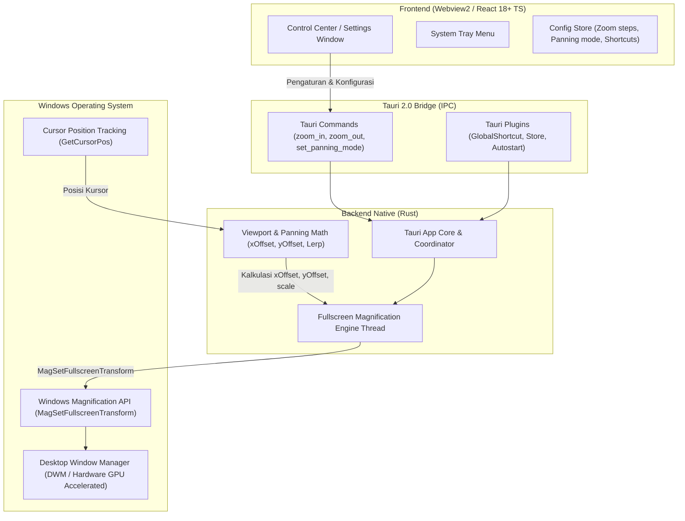

# Development Roadmap & Project Specification: Window Pointer Zoom (Full-Screen Zoom)

Aplikasi utilitas Windows desktop untuk melakukan pembesaran **seluruh layar (*Full-Screen Desktop Zoom*)** secara dinamis, di mana tampilan layar membesar (*zoom in/out*) dan viewport kamera layar bergeser (*panning*) mengikuti pergerakan kursor mouse secara *real-time*.

---

## 1. Ringkasan Proyek (Project Overview)

* **Nama Proyek:** Window Pointer Zoom (Full-Screen Desktop Zoom Utility)
* **Target Platform:** Windows 10 & Windows 11 (64-bit)
* **Arsitektur:** **Hybrid Architecture** (Tauri 2.0 + React TypeScript + Native Windows Fullscreen Magnification Engine)
* **Konsep Utama (Bukan Lensa Bulat / Bukan Kaca Pembesar):**
  - **Full-Screen Scaling:** Ketika fitur zoom aktif, **seluruh monitor/layar** diperbesar (*zoom in* ke 1.5x, 2.0x, 3.0x, dst.).
  - **Pointer-Centric Viewport:** Area yang ditampilkan dan difokuskan pada layar yang diperbesar adalah area di sekitar pointer mouse.
  - **Dynamic Panning:** Saat pointer mouse digerakkan, viewport layar secara dinamis dan mulus bergeser (*pan*) mengikuti pergerakan kursor agar kursor dan area sekitarnya selalu terlihat di layar.
  - **Smooth Zoom In / Out:** Transisi pembesaran dan pengecilan layar kembali ke 1.0x (normal) berjalan halus (*animated/smooth interpolation*).
  - **Nilai Guna:** Sangat efektif untuk presentasi teknis, rekaman tutorial video (*screen recording*), demonstrasi UI/coding, serta alat bantu aksesibilitas visual.

---

## 2. Arsitektur Teknis (Hybrid Architecture)

### Mengapa Pendekatan Hybrid untuk Full-Screen Zoom?
1. **Dukungan Native OS Level (`MagSetFullscreenTransform`):**  
   Windows memiliki fungsi native resmi untuk memperbesar seluruh layar langsung di tingkat kompositor DWM (*Desktop Window Manager*). Hasilnya adalah pembesaran 60–144+ FPS dengan akselerasi GPU tanpa lag render.
2. **Tanpa Rekursi Gambar:**  
   Karena DWM langsung memanipulasi transformasi layar sistem, kita tidak memerlukan teknik penangkapan frame/screenshot manual.
3. **UI Pengaturan Modern (React TS):**  
   Pengguna mengonfigurasi tombol shortcut, kecepatan animasi zoom, batas deadzone panning, dan tingkat pembesaran melalui UI desktop yang estetik.

---

## 3. Rumus & Cara Kerja Matematis Viewport Panning

Ketika layar diperbesar dengan faktor $\text{scale} > 1.0$:

1. **Ukuran Viewport yang Tampak:**
   $$\text{viewWidth} = \frac{\text{screenWidth}}{\text{scale}}$$
   $$\text{viewHeight} = \frac{\text{screenHeight}}{\text{scale}}$$

2. **Kalkulasi Offset Sudut Kiri-Atas Layar ($xOffset, yOffset$):**
   Agar kursor berada tepat di tengah layar yang di-zoom:
   $$\text{targetX} = \text{cursor.x} - \left(\frac{\text{viewWidth}}{2}\right)$$
   $$\text{targetY} = \text{cursor.y} - \left(\frac{\text{viewHeight}}{2}\right)$$

3. **Clamping (Mencegah Layar Melebihi Batas Fisik Desktop):**
   $$\text{xOffset} = \max(0, \min(\text{targetX}, \text{screenWidth} - \text{viewWidth}))$$
   $$\text{yOffset} = \max(0, \min(\text{targetY}, \text{screenHeight} - \text{viewHeight}))$$

4. **Smooth Interpolation (Lerp):**  
   Untuk transisi yang halus (tidak kaku), nilai $xOffset$, $yOffset$, dan $scale$ diinterpolasi menggunakan LERP (*Linear Interpolation*) setiap tick (misal 60–120 Hz).

---

## 4. Komponen Teknologi Kunci

| Komponen | Teknologi | Deskripsi / Peran |
| :--- | :--- | :--- |
| **Framework Aplikasi** | **Tauri 2.x (Latest Stable)** | Runtime desktop ringan berbasis Rust & Webview2. |
| **Frontend UI** | **React 18/19 + TypeScript + Vite** | Antarmuka dashboard, kontrol slider zoom, preset, dan shortcut. |
| **Styling & Komponen** | **Tailwind CSS + Shadcn UI / Radix** | Komponen UI modern, bersih, dan mendukung Dark/Light mode. |
| **Backend Core** | **Rust (2021 edition)** | Concurrency, mathematical interpolation, dan thread koordinasi. |
| **Magnification Engine**| **`windows` Crate (`Win32_UI_Magnification`)** | Memanggil `MagInitialize`, `MagSetFullscreenTransform`, `MagUninitialize`. |
| **Sistem Tombol Cepat** | **`@tauri-apps/plugin-global-shortcut`** | Mendengarkan hotkey global OS (misal `Win + Alt + Z`, `Ctrl + Alt + Scroll`). |
| **Penyimpanan State** | **`@tauri-apps/plugin-store`** | Menyimpan konfigurasi pengguna (step zoom, max zoom, mode panning) ke JSON. |

---

## 5. Rencana & 6 Fase Pengembangan (Revisi untuk Full-Screen Zoom)

### Fase 1: Core Engine Full-Screen Magnification (PoC Rust)
*Fokus: Memvalidasi kemampuan pembesaran seluruh layar dan kalkulasi offset viewport mengikuti kursor.*
* **Aktivitas yang dikerjakan:**
  - Menyiapkan crate `windows` (fitur `Win32_UI_Magnification`, `Win32_Foundation`, `Win32_UI_WindowsAndMessaging`).
  - Menginisialisasi Magnification API (`MagInitialize`).
  - Menguji pemanggilan `MagSetFullscreenTransform(magLevel, xOffset, yOffset)`:
    - Mengubah level dari 1.0x ke 2.0x (seluruh layar membesar).
    - Menghitung koordinat sudut $(xOffset, yOffset)$ berdasarkan posisi mouse (`GetCursorPos`).
    - Menggeser viewport saat mouse bergerak sehingga area di sekitar pointer selalu terlihat.
  - Menerapkan perataan pergerakan (*smoothing / lerp*) agar perpindahan viewport terasa sinematik dan tidak memicu pusing.
  - Memastikan reset kembali ke layar normal 1.0x berfungsi mulus.
* **Output / Definition of Done (DoD):**
  - [ ] Binary prototipe Rust berhasil memperbesar seluruh layar saat diaktifkan.
  - [ ] Viewport seluruh layar bergeser mulus mengikuti kursor mouse saat kursor mendekati tepi atau bergerak.
  - [ ] Layar dapat di-reset kembali ke ukuran 1.0x tanpa distorsi visual.

---

### Fase 2: Integrasi Arsitektur Tauri 2.0 & Jembatan IPC
*Fokus: Mengintegrasikan engine fullscreen zoom ke dalam Tauri 2.0 dan menyediakan API perintah IPC.*
* **Aktivitas yang dikerjakan:**
  - Setup template proyek Tauri 2.0 (`tauri` + `react-ts` + `vite`).
  - Memindahkan engine fullscreen ke background worker thread di Rust (`src-tauri/src/engine/`).
  - Merancang state thread-safe (`AppState`) untuk mengontrol:
    - Target zoom level vs Current zoom level (animator lerp).
    - Status aktif / nonaktif.
    - Konfigurasi mode panning (*Center Follow* vs *Edge Panning*).
  - Menyediakan Tauri Commands untuk frontend:
    - `zoom_in()` (menaikkan zoom per step, misal +0.25x).
    - `zoom_out()` (menurunkan zoom per step).
    - `reset_zoom()` (kembali ke 1.0x).
    - `set_zoom_level(scale: f32)`.
    - `update_panning_config(...)`.
  - Mengonfigurasi capabilities Tauri 2.0 (`src-tauri/capabilities/default.json`).
* **Output / Definition of Done (DoD):**
  - [ ] Aplikasi Tauri 2.0 dapat dijalankan (`npm run tauri dev`).
  - [ ] Tombol pengujian di React dapat memicu Zoom In, Zoom Out, dan Reset pada seluruh layar dengan transisi yang halus.

---

### Fase 3: Integrasi Sistem Operasi (Global Shortcuts, Scroll Trigger & Tray)
*Fokus: Menyediakan kontrol global cepat yang bisa digunakan saat membuka aplikasi lain.*
* **Aktivitas yang dikerjakan:**
  - Memasang `@tauri-apps/plugin-global-shortcut`.
  - Mendaftarkan kombinasi hotkey fleksibel:
    - Toggle Zoom Instan (misal `Win + Alt + Z` untuk beralih antara 1.0x dan 2.0x).
    - Tombol Zoom Bertahap (misal `Win + Alt + Up / Down` atau `Win + Plus / Minus`).
  - Eksplorasi deteksi modifier key + Mouse Wheel (misal `Ctrl + Alt + Mouse Wheel Up/Down` untuk zoom in/out dinamis di bawah kursor).
  - Mengonfigurasi System Tray di Tauri 2.0 (ikon tray, opsi *Reset Zoom*, *Settings*, *Exit*).
  - Mengatur window utama agar tersembunyi ke Tray saat di-minimize/close.
  - Memasang `@tauri-apps/plugin-single-instance`.
* **Output / Definition of Done (DoD):**
  - [ ] Pengguna dapat men-zoom in/out seluruh layar menggunakan keyboard shortcut atau scroll mouse di aplikasi mana pun.
  - [ ] Aplikasi menetap di System Tray dan dapat dikontrol tanpa harus menampilkan window utama.

---

### Fase 4: Pengembangan UI/UX (React + TS + State Persistence)
*Fokus: Antarmuka dashboard kontrol yang kaya fitur, intuitif, dan responsif.*
* **Aktivitas yang dikerjakan:**
  - Setup Tailwind CSS dan komponen UI (Shadcn UI / Radix Primitives).
  - Membangun halaman pengaturan:
    - **Slider Batas Zoom:** Menentukan rentang zoom (misal Min: 1.0x, Default: 2.0x, Max: 5.0x).
    - **Step Zoom:** Besar kelipatan setiap zoom in/out (0.1x, 0.25x, 0.5x).
    - **Mode Panning:**
      - *Center-locked:* Pointer selalu berada di tengah viewport.
      - *Edge Panning / Deadzone:* Viewport baru bergeser saat pointer mendekati area tepi layar.
    - **Kecepatan Animasi Zoom & Panning:** Slider untuk mengatur responsivitas lerp (instan hingga sangat halus/cinematic).
    - **Shortcut Configurator:** UI untuk merekam kombinasi tombol kustom pengguna.
    - **Toggle Start on Boot:** Menggunakan `@tauri-apps/plugin-autostart`.
  - Integrasi `@tauri-apps/plugin-store` untuk persistensi preferensi ke disk (JSON).
* **Output / Definition of Done (DoD):**
  - [ ] Tampilan UI React TS yang modern dan mendukung Dark/Light mode.
  - [ ] Seluruh perubahan pengaturan di UI langsung berdampak pada perilaku fullscreen zoom dan tersimpan permanen.

---

### Fase 5: Input Mapping, Multi-Monitor & DPI Scaling
*Fokus: Memastikan klik mouse akurat saat layar diperbesar dan kompatibel dengan setup monitor yang beragam.*
* **Aktivitas yang dikerjakan:**
  - **Akurasi Klik Mouse (Input Coordinate Mapping):**  
    Ketika layar diperbesar secara penuh via `MagSetFullscreenTransform`, memeriksa dan menangani pemetaan klik agar klik mouse tetap mengenai target yang benar pada aplikasi di bawahnya dengan memanggil `MagSetInputTransform(TRUE, &pRectSource, &pRectDest)` yang disinkronkan dengan transformasi viewport.
    - **Catatan Teknis & Keterbatasan Windows OS:** Pada Windows 10 (1703+) & Windows 11, tanpa `MagSetInputTransform`, OS merutekan klik mouse ke koordinat desktop asli (*unmagnified*), bukan ke posisi visual yang di-zoom (sehingga area seperti baris teratas File Explorer mode *Details* bisa gagal diklik/diseleksi seiring kenaikan faktor zoom). Selain itu, `MagSetInputTransform` **wajib memiliki hak `UIAccess`** (jika tidak, Windows menolak dengan `ERROR_ACCESS_DENIED`, bahkan saat dijalankan sebagai Administrator biasa). Oleh karena itu, pemanggilan `MagSetInputTransform` harus melakukan *graceful fallback* pada build dev lokal (*unsigned*) agar fungsi zoom tetap berjalan normal, sedangkan akurasi klik penuh baru dapat diverifikasi pada build ter-sign dengan `UIAccess` (lihat Fase 6). Komponen WinUI/XAML Islands pada bar atas File Explorer Windows 11 juga memiliki perilaku *hit-testing* bawaan OS di bawah fullscreen magnification yang berada di luar kendali aplikasi.
  - **Per-Monitor DPI Awareness:**  
    Memastikan kalkulasi offset viewport akurat pada display dengan scaling DPI 125%, 150%, 175%, atau 200%.
  - **Multi-Monitor Handling:**  
    Mengatur perilaku zoom saat sistem memiliki lebih dari satu monitor (apakah zoom hanya berlaku di monitor aktif di mana kursor berada, atau mencakup virtual desktop).
  - **Clean Shutdown:**  
    Memastikan saat aplikasi keluar (*exit*), layar otomatis kembali ke 1.0x secara instan dan memanggil `MagUninitialize()`.
* **Output / Definition of Done (DoD):**
  - [ ] Klik mouse pada tombol atau teks saat layar diperbesar tetap presisi (diuji pada build ter-sign dengan `UIAccess` aktif di lokasi instalasi terlindungi; build dev lokal *unsigned* hanya memvalidasi *graceful fallback* tanpa crash).
  - [ ] Berjalan stabil pada monitor high-DPI (laptop 1080p 125% maupun 4K).
  - [ ] Tidak ada distorsi layar saat aplikasi ditutup.

---

### Fase 6: Packaging, Installer & Dokumentasi
*Fokus: Pembuatan installer resmi dan dokumentasi penggunaan.*
* **Aktivitas yang dikerjakan:**
  - Menyiapkan icon pack aplikasi (`.ico`).
  - Mengonfigurasi bundler Tauri 2.0 untuk menghasilkan installer **NSIS (`.exe`)** dan **MSI (`.msi`)**.
  - **Konfigurasi Manifest & Syarat Wajib `UIAccess` (untuk `MagSetInputTransform`):**
    Agar Windows mengizinkan pemetaan klik `MagSetInputTransform` pada build rilis (tidak ditolak dengan `ERROR_ACCESS_DENIED`), distribusi produksi harus memenuhi ketiga syarat keamanan Windows UAC/UIPI secara bersamaan:
    1. Manifest Windows menyertakan `<requestedExecutionLevel level="asInvoker" uiAccess="true" />`.
    2. Binary ditandatangani secara digital (**Authenticode code signing**) dengan sertifikat tepercaya yang berantai ke *Trusted Root* (untuk pengujian lokal dengan *self-signed certificate*, sertifikat perlu dipasang manual ke *Trusted Root* mesin).
    3. Installer (NSIS/MSI) memasang aplikasi ke lokasi terlindungi Windows (`%ProgramFiles%`, `%ProgramFiles(x86)%`, atau `%WinDir%\System32\`), karena menjalankan binary dari folder dev/Desktop/Downloads akan otomatis mencabut hak `UIAccess`.
  - Pengujian instalasi & uninstalasi bersih pada Windows 10 & Windows 11.
  - Pembuatan panduan penggunaan (README / cheatsheet tombol cepat).
* **Output / Definition of Done (DoD):**
  - [ ] Installer standalone (`.exe` / `.msi`) yang teruji dan siap didistribusikan.
  - [ ] Dokumentasi lengkap siap pakai untuk pengguna.

---